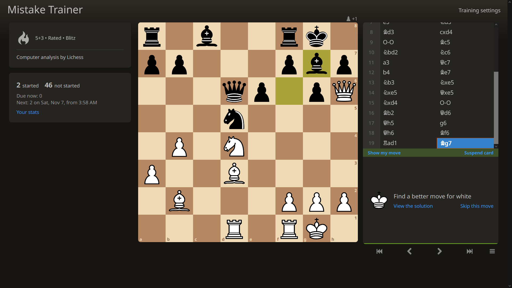
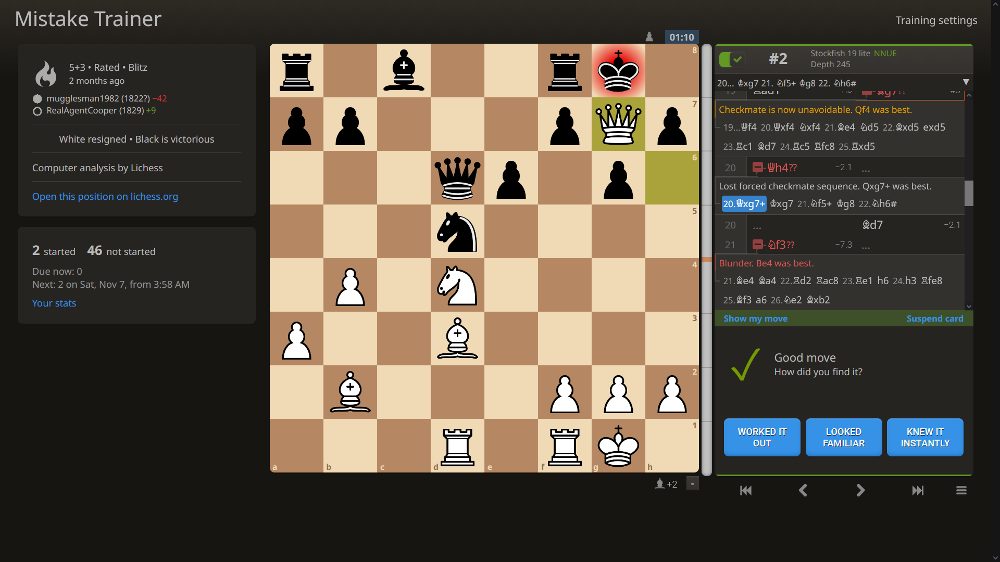

# Mistake Trainer

Spaced repetition on the mistakes from your own Lichess games.

**Try it at [mistake-trainer.pages.dev](https://mistake-trainer.pages.dev).** There's nothing to
install and you don't need an account. A sample deck lets you look around first.

<p>
  
  
</p>

On the left a card asks for a better move than the one you played. On the right you've found one
and say how it went.

## What it is

Lichess's analysis board has "Learn from your mistakes". It steps through one game and asks you to
find a better move at each position where you went wrong. Mistake Trainer does this for all your
analysed games at once. Each mistake becomes a card and FSRS (the scheduler Anki uses) brings it
back just before you'd forget it.

The board and the panel beside it are Lichess's own, ported from
[lila](https://github.com/lichess-org/lila), the software behind lichess.org. Mistakes are found
by the same rules and your answers are judged the same way. So it should feel like Lichess.

It's a personal project and isn't affiliated with or endorsed by Lichess. If you find it useful
please consider [supporting Lichess](https://lichess.org/patron).

## How it works

- You give your Lichess username. Mistake Trainer downloads your games with their computer
  analysis from the [Lichess API](https://lichess.org/api) and makes a card for each mistake. New
  cards come from your 20 most recent games to begin with.
- Only your first try counts. A move other than the engine's best is checked by
  [Stockfish](https://stockfishchess.org/) and counts if it's nearly as good. After a right move
  you say how it went with Worked it out, Looked familiar or Knew it instantly.
- Once a card is done you see the game's analysis and can switch the engine on to look further.
- If you sign in with Lichess, opening mistakes are checked against its
  [masters database](https://lichess.org/analysis#explorer). A move masters have played isn't a
  mistake and their other moves count as right answers.
- Games Lichess hasn't analysed can be analysed in your browser the way Lichess's servers do it,
  as in [fishnet](https://github.com/lichess-org/fishnet).
- In Training settings you choose which cards come first, how many new cards you get a day and how
  far apart reviews are.

## Your data

Mistake Trainer has no server that sees your data. The website keeps everything in your browser.
Export saves it all in one file and Import brings it back, there or in another browser. Your
browser can delete a site's data (Safari may after seven days without a visit) so export now and
then to keep a copy.

Signing in with Lichess is optional. It lets opening mistakes be checked against the masters
database and makes your games download faster. You sign in on Lichess's own page and Mistake
Trainer gets only your username and no permissions. Your sign-in is only ever sent to Lichess.

## Running it on your own computer

Running it yourself gives Stockfish's full network rather than the website's smaller "lite" one,
and keeps everything in files. You need [Node.js](https://nodejs.org/) 22.12 or newer and git.

```sh
git clone https://github.com/DannyNagelMath/Mistake-Trainer.git
cd Mistake-Trainer
npm install
npm run dev
```

Then open the address it prints. Everything is saved in the `data` folder and a copy of your
reviews is made each day in `data/backups`. Export and Import work here too, so you can move your
deck between your computer and the website.

## Development

```sh
npm test         # the tests, with Vitest
npm run check    # type checks
npm run build    # the website, in dist
```

GitHub runs all three on every push, on Linux, macOS and Windows.

## Licence

Mistake Trainer is free software: you can redistribute it and/or modify it under the terms of the
GNU Affero General Public License as published by the Free Software Foundation, either version 3 of
the License, or (at your option) any later version. See [LICENSE](LICENSE). It uses this licence
because much of it is ported from lila, which is licensed the same way.

- Portions copyright (c) 2012-2026 the
  [lila authors](https://github.com/lichess-org/lila/graphs/contributors).
- Everything else copyright (c) 2026 Dan Nagel.

Each file ported from lila says which lila file it comes from, at lila commit
[27ffc8b](https://github.com/lichess-org/lila/tree/27ffc8b5f296d180e7a648d6bfdad27eef3f86a2). Every
change from lila's version is marked in the code with a comment: `Trim:` where something was
removed or simplified, `Fix:` for a bug fix, and `Not in lila:` for additions.

The AGPL also covers use over a network: if you run Mistake Trainer as a service for other people,
you must offer them its source code.

### Third-party code and assets

- `src/mousetrap.ts` is lila's adaptation of [Mousetrap](https://craig.is/killing/mice),
  copyright 2012-2017 Craig Campbell, under the Apache License 2.0 (see the notice in the file).
- The dependencies that `npm install` fetches aren't included in this repository:
  [chessground](https://github.com/lichess-org/chessground) and
  [chessops](https://github.com/niklasf/chessops) (GPL-3.0-or-later),
  [snabbdom](https://github.com/snabbdom/snabbdom) and
  [ts-fsrs](https://github.com/open-spaced-repetition/ts-fsrs) (MIT),
  [stockfish.js](https://github.com/nmrugg/stockfish.js), Stockfish compiled to WebAssembly
  (GPL-3.0), and development tools under MIT or Apache 2.0.
- lila's stylesheets, fonts, piece sets, board image, and help videos are in `public/lila`,
  built from lila's source by `scripts/buildLilaCss.ts`. They keep their own licences, all
  free: `public/lila/README.md` lists each file's authors and licence, and the licences' texts
  are beside it. If you change the board or pieces, check their entry in lila's
  [COPYING.md](https://github.com/lichess-org/lila/blob/27ffc8b5f296d180e7a648d6bfdad27eef3f86a2/COPYING.md):
  some of lila's are non-free or non-commercial.
- Mistake Trainer doesn't use the Lichess name or logo as its own; lila's COPYING.md reserves the
  logo for referring to lichess.org.
- The games in `fixtures` and in the sample deck (`public/sample.json`) are from lichess.org,
  whose game database Lichess releases under [CC0](https://database.lichess.org/).

## AI assistance

Most of the code was written with Anthropic's Claude, under Dan Nagel's direction: the first steps
through the Claude chat app, and the rest with Claude Code, its coding tool. Commits made with
Claude Code end with a `Co-Authored-By: Claude` line.
